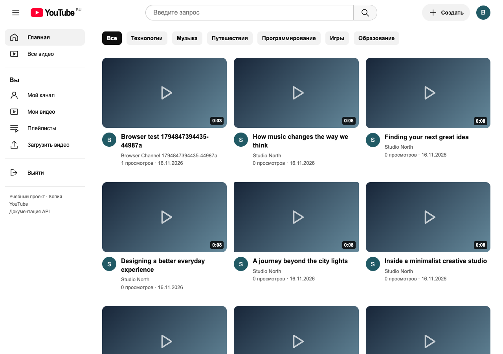

# YouTube clone

Source: [https://github.com/VARAGer/youtube-clone](https://github.com/VARAGer/youtube-clone).

Temporary live demo: [https://forest-crm-imagine-downloading.trycloudflare.com](https://forest-crm-imagine-downloading.trycloudflare.com).
Runs while the Mac and tunnel are online; uploads are limited to 20 MiB.
See [demo access and lifetime](docs/DEMO.md).

Verified on clean Ubuntu 24.04: **41 API tests**, **3 real browser scenarios**,
PostgreSQL/S3/FFmpeg lifecycle and concurrency checks, and a complete
backup/restore with matching database counts and video SHA-256.
Hosted CI passed: [https://github.com/VARAGer/youtube-clone/actions/runs/44127094756](https://github.com/VARAGer/youtube-clone/actions/runs/44127094756).
See [the executed verification record](docs/verification.md) for scope and evidence.



FastAPI + PostgreSQL + private S3-compatible object storage, a separate FFmpeg
worker, and a responsive same-origin frontend. The implementation includes a
video feed, watch page with seeking, search, channels, subscriptions, playlists,
upload progress, comments, likes, private-video grants, reporting, moderation
and role administration.

## One-command start on clean Ubuntu

```sh
bash scripts/deploy.sh
```

Open **http://localhost:8080**; Swagger is **http://localhost:8080/docs**.
Root/sudo and an internet connection are needed if Docker is not installed.
The initial run builds images and generates sample clips, so allow several minutes.
Direct access through a VM IP also works by default. To pin the accepted
origin explicitly (recommended behind a reverse proxy):

```sh
PUBLIC_ORIGIN=http://YOUR_VM_IP:8080 bash scripts/deploy.sh
```

Only the app port is exposed; PostgreSQL and MinIO remain internal. Runtime data
is held in persistent Docker volumes. Production internet hosting requires an
HTTPS reverse proxy and `COOKIE_SECURE=true`.

## Demo accounts

| Email | Role | Use |
|---|---|---|
| creator@demo.local | User | Owns seeded videos, edits and grants recipients |
| viewer@demo.local | User | Likes/comments; allowed private preview recipient |
| moderator@demo.local | Moderator | Reviews reports and hides videos |
| admin@demo.local | Administrator | Moderation and role management |

The shared demo password is randomly generated in your private `.env` as
`DEMO_PASSWORD`. There is no universal default admin password. New user
registration is available through the UI. Demo assets are generated locally
with FFmpeg and require no third-party media downloads.

## Engineering material

- [Architecture and data](docs/architecture.md)
- [API contract](docs/contract.md)
- [Security and limits](docs/security.md)
- [Operations and backups](docs/operations.md)
- [Actual verification record](docs/verification.md)
- [AI orchestration rules](AGENTS.md)

Backend modules are in `backend/app`, UI in `frontend`, critical tests in `tests`.
The native AI-tool session files belong in `ai-sessions/` unchanged. They are not
replaced by prose summaries, screenshots, or copied messages.

## Verification commands

After deployment, run both the application regression suite and the real
PostgreSQL/S3/FFmpeg acceptance scenario:

```sh
docker compose exec -T app python -m unittest discover -s tests -v
docker compose exec -T app python scripts/smoke.py
docker compose exec -T app python scripts/integration_runtime.py
```

Browser tests exercise actual playback and capture desktop/mobile screenshots.
Install Node.js 22 LTS and FFmpeg on the test machine, then run:

```sh
cd frontend
npm ci --ignore-scripts
npx playwright install --with-deps chromium
BASE_URL=http://localhost:8080 npm test
```

Alternatively set `E2E_VIDEO` to an existing real MP4 fixture to avoid needing
FFmpeg on the browser test machine. The CI workflow generates that fixture in
the app container and executes all three verification stages. Browser results
are saved in `frontend/test-results` and `frontend/playwright-report`.

## Submission archive

```sh
python3 scripts/package.py
```

For an explicitly selected native continuation session whose working directory
differs from this checkout, pass `--session-file /absolute/path/to/rollout.jsonl`
(repeat for each agent). Native `.jsonl.zst` snapshots are also supported.

The script preserves the complete `.git` directory and all commits, selects
only project-native Codex JSONL session files, and excludes secrets/caches.
If this ChatGPT Work session is not written to local Codex JSONL files, obtain
its official export from the tool and supply the native project session
directory with `--session-root`, or an exact project-only export file with
`--native-export /path/to/export.json`. Do not provide an all-conversations
export containing unrelated private chats. The packager refuses to call an archive
complete when native sessions are absent. A development-only archive can be
created with `--allow-missing-sessions`; it is explicitly incomplete.

See the verification record for what was actually run. Do not infer successful
Ubuntu deployment or browser playback merely from unit tests passing.

The 2026-11-16 continuation includes real rendered evidence under `docs/evidence/`
and native continuation session snapshots under `ai-sessions/` when packaged.
The original pre-handoff dialogue export is unavailable; see
`ai-sessions/README.md`. The presence of continuation snapshots does not mean
that every original dialogue is included.
