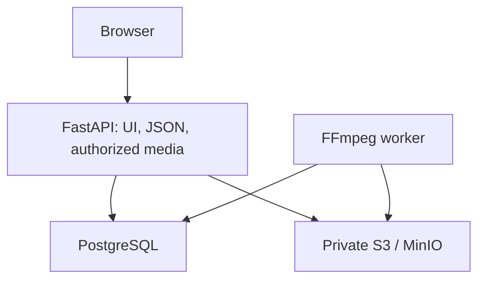

# Architecture and data model

The system is a modular monolith plus a separate worker. A same-origin FastAPI
application serves the frontend and JSON API. PostgreSQL is the authority for
users, sessions, social actions, access grants, moderation and video state.
An S3-compatible private bucket stores originals, transcoded MP4s and thumbnails.
The bucket has no anonymous read policy and no published host port. The browser
receives media only through authorized API routes, including byte-range reads.

The API accepts a bounded multipart stream, assigns server-generated object
keys, persists an upload, and returns a processing state. The independent worker
claims a job, validates media with ffprobe, invokes ffmpeg with argument arrays,
writes an H.264/AAC MP4 with faststart and a thumbnail, then marks the video ready.
PostgreSQL work claiming avoids introducing another broker for this scope.
A failed or crashed worker must not leave a video falsely marked ready.

## Data ownership

| Data | Authority | Rules |
|---|---|---|
| Accounts, password hashes, role | PostgreSQL | Registration always creates a user role |
| Sessions | PostgreSQL | Opaque cookie, expiry and explicit logout |
| Video metadata and state | PostgreSQL | Owner edit; visibility enforced on reads |
| Original, MP4, thumbnail | Private object storage | Random object keys; API checks every read |
| Private-video recipients | PostgreSQL | Explicit owner-created grant |
| Likes and subscriptions | PostgreSQL | Unique user-target pairs |
| Comments | PostgreSQL | Author identity comes from session |
| Playlists and membership | PostgreSQL | Response filters inaccessible videos |
| Reports and moderation | PostgreSQL | Staff actions hide video; no private ACL bypass |

Public videos appear in listings. Unlisted videos require the direct URL and
are excluded from discovery. Private videos require ownership or an explicit
recipient grant. Staff roles do not provide access to private media. Hidden
content cannot be played. Authorization applies to metadata, thumbnails,
comments, playlists and both full and Range media reads.

The generated demo clips require no network assets or copyright permissions.
Production stores are durable volumes; deleting containers does not delete data.
